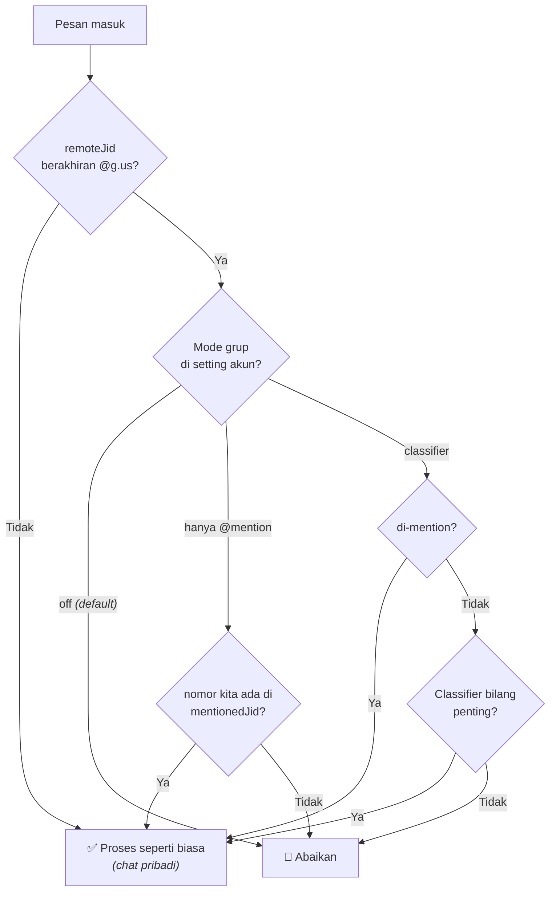
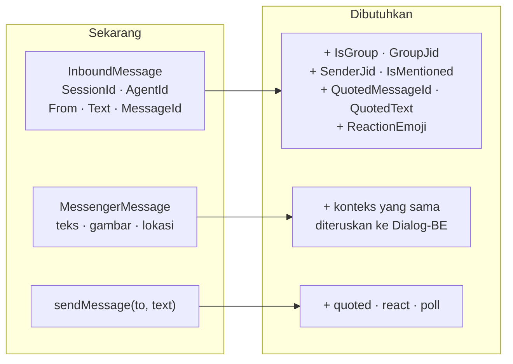

# Riset kelayakan fitur — Baileys (Qlar Self-hosted)

Menjawab temuan diskusi tim: grup/@mention, reply, reaksi emoji, dan tombol interaktif.
**Bisa atau tidak?** — diverifikasi langsung dari library yang terpasang.

---

## ⚠️ Ruang lingkup: HANYA Baileys

Dokumen ini **hanya** membahas protokol **Baileys (Qlar Self-hosted)**.

| Protokol | Status pengembangan |
|---|---|
| **Baileys** (Qlar Self-hosted) | ✅ **Dikembangkan** — fokus dokumen ini |
| MetaCloud | ❌ **TIDAK dikembangkan** |
| Qontak | ❌ **TIDAK dikembangkan** |
| Coster | ❌ **TIDAK dikembangkan** |
| Instagram | ❌ **TIDAK dikembangkan** |

Keempat protokol non-Baileys **tidak disentuh** dalam pekerjaan ini. Kode mereka
dibiarkan apa adanya. Kalau nanti ada permintaan untuk menyamakan fitur, itu pekerjaan
terpisah dengan riset terpisah — beberapa fitur di sini bahkan mustahil di sana (Cloud
API tidak punya grup sama sekali).

Satu-satunya perubahan yang sudah menyentuh semua protokol adalah **konversi markdown**,
dan itu sudah selesai & merged (`90cda7b`) di luar cakupan dokumen ini.

---

## Metode verifikasi

Semua jawaban di bawah **bukan** dari dokumentasi atau asumsi, melainkan dibaca langsung
dari file definisi tipe di:

```
connector/node_modules/@whiskeysockets/baileys@7.0.0-rc13/lib/Types/
```

> ⚠️ Catatan versi: connector memakai **7.0.0-rc13** (release candidate). Folder
> `baileys-gateway/` memakai **6.7.23** — beda versi, beda kemampuan. Yang berlaku untuk
> produksi adalah versi connector.

---

## Hasil: bisa atau tidak?

| # | Fitur | Bisa? | Bukti |
|---|---|---|---|
| 1 | Deteksi grup + siapa pengirimnya | ✅ **Bisa** | `key.participant`, event `groups.upsert` / `group-participants.update` |
| 2 | Deteksi di-mention (@) | ✅ **Bisa** | `mentionedJid` ada di `WAProto/index.d.ts` |
| 3 | Terima reply (tahu pesan yang dikutip) | ✅ **Bisa** | `contextInfo.quotedMessage` + `stanzaId` |
| 4 | Kirim reply (mengutip pesan tertentu) | ✅ **Bisa** | `MiscMessageGenerationOptions.quoted?: WAMessage` |
| 5 | Kirim reaksi emoji | ✅ **Bisa** | `react: proto.Message.IReactionMessage` |
| 6 | Terima reaksi emoji | ✅ **Bisa** | event `'messages.reaction': { key, reaction }[]` |
| 7 | **Tombol interaktif** | ❌ **TIDAK BISA** | `buttons` / `templateButtons` / `sections` **tidak ada** di konten yang bisa dikirim |
| 8 | **Poll** (pengganti tombol) | ✅ **Bisa** | `poll: PollMessageOptions` + `getAggregateVotesInPollMessage` |

**Lima dari enam permintaan bisa dikerjakan.** Yang gugur hanya tombol — tapi ada
penggantinya yang cukup baik (poll).

---

## Detail per fitur

### 1–2. Grup & @mention ✅

Baileys memberikan semua yang dibutuhkan:

- `msg.key.remoteJid` berakhiran `@g.us` → ini pesan grup
- `msg.key.participant` → **siapa** yang bicara di grup itu
- `contextInfo.mentionedJid` → daftar JID yang di-@ dalam pesan

Sekarang di [waSession.ts](../src/server/waSession.ts) ketiganya dibuang:

```ts
const from = msg.key.remoteJid ?? ''   // grup jadi "xxx@g.us", participant hilang
cb.onMessage({ from, text, messageId }) // tanpa konteks grup sama sekali
```

> 🚨 **Risiko aktif, bukan sekadar fitur yang belum ada.** Tidak ada filter grup di
> connector maupun Messenger-BE. Kalau nomor ini dimasukkan ke grup hari ini, **setiap
> pesan grup jadi inbound dan AI menjawab semuanya.** Perlu ditutup lebih dulu.

Alur keputusan yang diusulkan:



Soal **classifier**: menambah 1 panggilan AI per pesan grup. Di grup ramai itu biaya dan
latensi nyata. Saran: opt-in, model murah, **default mati**.

### 3–4. Reply / quoted ✅

Dua arah, keduanya didukung:

**Terima** — `extendedTextMessage.contextInfo` berisi `stanzaId` (id pesan yang dikutip)
dan `quotedMessage` (isinya). Sekarang dibuang total.

**Kirim** — `Message.d.ts:246` → `quoted?: WAMessage`. Pemakaian:
```ts
await socket.sendMessage(jid, { text }, { quoted: originalMsg })
```

💡 Connector **sudah** menyimpan pesan di `messageStore` (dipakai untuk `getMessage`),
jadi bahan untuk mengutip sudah tersedia — tinggal dipakai.

### 5–6. Reaksi emoji ✅

**Kirim** — `Message.d.ts:187`:
```ts
await socket.sendMessage(jid, { react: { text: '👍', key: msg.key } })
```

**Terima** — event terpisah, `Events.d.ts:84`:
```ts
'messages.reaction': { key: WAMessageKey; reaction: proto.IReaction }[]
```

> Sekarang reaksi **hilang diam-diam**. Connector cuma dengar `messages.upsert`, dan di
> sana ada `if (!text) continue` — reaksi tidak punya teks, jadi langsung terbuang.
> Event `messages.reaction` belum di-subscribe sama sekali.

Ide 👎 → AI tanya "kurang memuaskan kenapa?" itu **logika Dialog-BE**, bukan
Messenger-BE. Messenger-BE cukup meneruskan reaksi sebagai *event*, bukan sebagai teks.

### 7. Tombol interaktif ❌ TIDAK BISA

Ini kesimpulan paling penting. `AnyRegularMessageContent` di Baileys 7 berisi:

```
text · event · poll · album · contacts · location · react
buttonReply · groupInvite · listReply · pin · product
```

`buttons`, `templateButtons`, dan `sections` **tidak ada di daftar itu**. Yang ada hanya
`buttonReply` dan `listReply` — itu untuk **membalas** tombol yang dikirim orang lain,
bukan untuk **mengirim** tombol.

Ini konsisten dengan kebijakan WhatsApp: dukungan tombol dicabut untuk klien non-resmi.
Di Baileys 6.x field `buttons` masih ada; di 7.x sudah dihapus.

**Kesimpulan: fitur tombol tidak bisa dikerjakan di Baileys.** Kalau tetap diperlukan,
satu-satunya jalan adalah lewat MetaCloud — dan itu di luar cakupan dokumen ini.

### 8. Poll — pengganti tombol yang realistis ✅

```ts
await socket.sendMessage(jid, {
  poll: { name: 'Apakah jawaban ini membantu?', values: ['Ya', 'Tidak'], selectableCount: 1 }
})
```

Jawabannya bisa dibaca dengan `getAggregateVotesInPollMessage()`
(`lib/Utils/messages.d.ts:62`).

Poll adalah fitur WhatsApp resmi yang berjalan normal di protokol WhatsApp Web, jadi
aman dipakai. Untuk kebutuhan "yes / no biar user gampang", ini pengganti terdekat —
user tinggal tap, tidak perlu mengetik.

Perbandingan jujur:

| | Tombol | Poll |
|---|---|---|
| Didukung Baileys | ❌ | ✅ |
| User tinggal tap | ✅ | ✅ |
| Jawaban instan | ✅ | ⚠️ lewat event vote, sedikit lebih lambat |
| Terasa natural dalam percakapan | ✅ | ⚠️ tampil sebagai kartu polling |

Fallback paling sederhana kalau poll pun dirasa janggal: teks bernomor
("Balas *1* untuk Ya, *2* untuk Tidak").

---

## Yang menghambat: amplop pesan kita terlalu sempit

Kelima fitur yang layak mentok di tempat yang sama:



Kalau dikerjakan satu per satu, plumbing yang sama dibongkar berkali-kali. **Perlebar
amplopnya sekali**, lalu semua fitur nempel di atasnya.

---

## Urutan yang disarankan

| Prioritas | Pekerjaan | Alasan |
|---|---|---|
| **1** | Filter grup (default: abaikan) | Menutup risiko aktif. Kecil dan berdiri sendiri. |
| **2** | Perlebar amplop pesan | Fondasi bersama untuk semua sisanya. |
| **3** | Reply (terima + kirim) | Nilai tertinggi, tanpa batasan platform. |
| **4** | Reaksi (terima + kirim) | Perlu perilaku baru di Dialog-BE untuk 👎. |
| **5** | Grup @mention penuh | Butuh setting CMS per-akun. |
| **6** | Classifier grup | Opt-in, default mati — ada biaya AI. |
| **7** | Poll sebagai pengganti tombol | Perlu spike dulu (lihat bawah). |
| — | ~~Tombol interaktif~~ | ❌ Dibatalkan — tidak didukung Baileys. |

---

## Batas keyakinan riset ini

Yang saya verifikasi adalah **kemampuan library**, dibaca dari definisi tipe yang
terpasang. Itu bukti kuat tapi bukan bukti runtime.

- ✅ **Yakin tinggi** — reply, reaksi: fitur WhatsApp standar, dipakai luas di Baileys.
- ⚠️ **Perlu spike** — poll: didukung library, tapi belum saya uji di akun kalian.
  Sebaiknya dicoba kirim satu poll ke nomor DEV sebelum masuk roadmap.
- ⚠️ **Perlu diperhatikan** — versi `7.0.0-rc13` masih release candidate; API bisa
  berubah sebelum rilis final.
- ✅ **Yakin tinggi (negatif)** — tombol: ketiadaannya di `AnyRegularMessageContent`
  bersifat definitif untuk versi ini.
